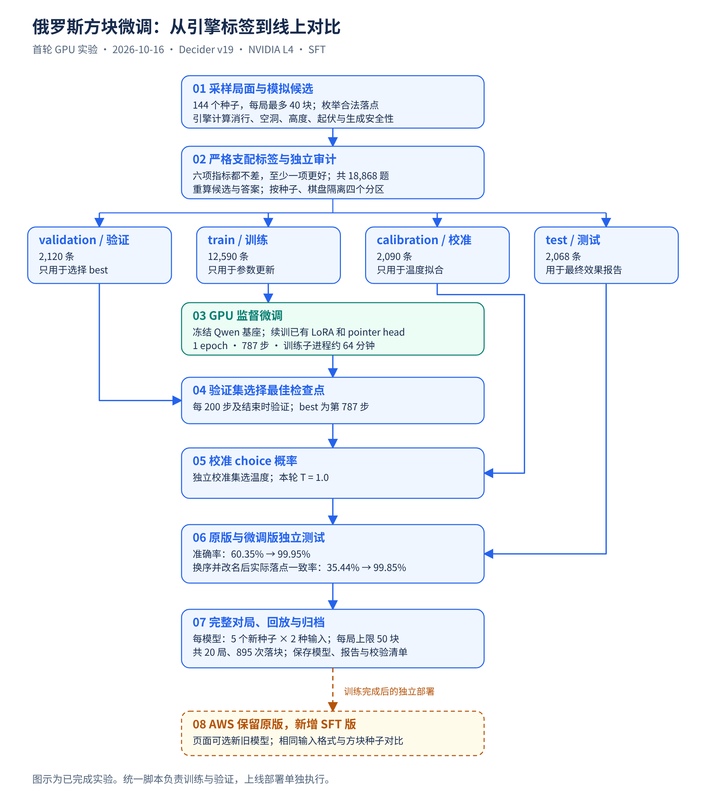
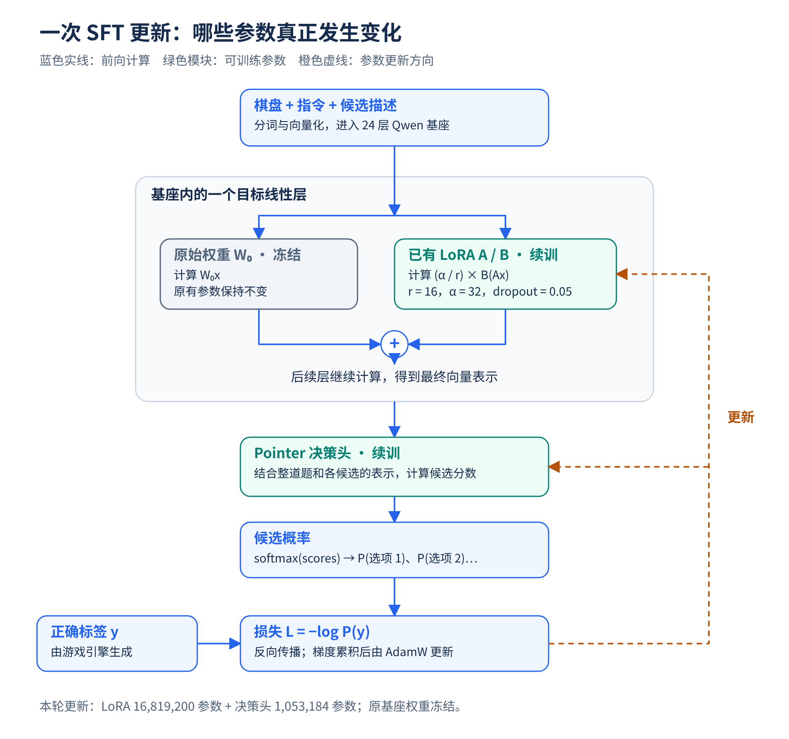

# 俄罗斯方块 Decider 微调全过程

本文记录 **2026-10-16 已完成的首轮 GPU 实验**，解释标签如何生成、模型如何更新、
效果如何验证，以及训练产物如何用于新旧版本对比。实际结果来自仓库内的训练记录和评估回执。

本轮采用 **SFT（监督微调）＋已有 LoRA 续训＋pointer 决策头续训**，冻结 Qwen3.5-2B 基座。
标签由游戏引擎自动计算，没有调用 GPT 教师，也没有执行 PPO 或 GRPO。

如果要直接运行自己的任务，见 [一键脚本使用说明](FINETUNE.md)；
如果只看本轮指标，见 [实验结果报告](../finetuning/RESULTS.md)。

## 1. 整体流程



[查看可缩放 SVG](diagrams/tetris-sft-workflow.svg)。图中最后一步是训练完成后的独立部署，
统一训练脚本不会自动上线。原版模型的测试使用同一 test 分区，与微调版形成对照。

| 阶段 | 输入 | 产出或验收依据 |
| --- | --- | --- |
| 生成与审计数据 | 游戏规则、固定种子、合法落点 | 四份 JSONL、manifest、audit |
| 环境与模型准备 | v19 权重、对应基座、固定版本上游代码 | 依赖、长度、硬件、初始权重检查 |
| GPU SFT | train；validation 用于选模型 | source、best、last 和训练日志 |
| 概率校准 | best＋calibration | calibrated 检查点 |
| 独立评估 | 原版与微调版＋test | 准确率、换序准确率、实际选择一致率 |
| 完整对局 | 两个模型、相同新种子、两种输入 | 游戏统计、原始响应、逐步回放 |
| 归档与上线 | 已验证的新检查点及报告 | 独立保存；页面保留新旧版本选择 |

## 2. 模型到底在学习什么

目标是根据当前棋盘、当前方块、下一块及候选落点的后果，选择更好的落点。

引擎已经完成合法落点枚举和落子模拟。输入中的消行、空洞、堆高等数值由引擎计算，
模型重点学习如何理解并比较这些事实。训练损失来自带正确答案的选择题；
完整游戏用于采样局面和训练后的评估，没有在训练循环中用整局回报更新策略。

本轮选择题的标签含义是：**在提供的候选集合内，某个候选在指定单步指标上支配其他候选。**
它不能证明该落点是所有未来方块序列下的最优策略。

## 3. 标签如何自动产生

### 3.1 采样不同棋盘

生成器使用 144 个种子，每局最多 40 块。访问局面的策略混合：

- 随机选择合法候选。
- 从不被其他候选支配的候选中随机选择。
- 按指标排序选择，并保留 10% 的随机探索。

这些策略只决定访问哪些棋盘。正确标签另外由候选之间的指标关系计算，
不会直接把某个采样策略的动作当作标准答案。

### 3.2 模拟候选，计算严格支配关系

对每个合法、可达落点，模拟放置和消行后的棋盘，计算以下六项：

| 指标 | 更好的方向 |
| --- | --- |
| 下一块能否生成 | 能生成 |
| 空洞数：方块下方被埋住的空格 | 更少 |
| 本次消行数 | 更多 |
| 最高列高度 | 更低 |
| 所有列高度之和 | 更低 |
| 相邻列高度差之和，即表面起伏 | 更小 |

当 A 的六项指标都不比 B 差，且至少一项更好，A 严格支配 B。
两个候选各有优劣或指标完全相同时，不强行给这一对指定唯一正确答案。

生成器选择一个能支配其他候选的落点，再抽取被它支配的候选，
构成二选一或 3～12 选一。这个胜出者只需要在本题抽出的候选中支配其他选项。
其余未入选候选可能存在不同取舍。

### 3.3 一条实际样本

训练文件第 267 行来自种子 `10001` 的第 27 步。当前方块 `Z`，下一块 `T`，
此前已消除 7 行。棋盘底部五行如下，上方十五行为空；`.` 为空格，`#` 为已占用格：

```text
.####.....
.####.....
######.###
######..##
######.###
```

三个候选执行后的实际指标为：

| 选项 ID | x | rotation | landing_y | 消行 | 空洞 | 最高高度 | 总高度 | 起伏 |
| --- | ---: | ---: | ---: | ---: | ---: | ---: | ---: | ---: |
| p676 | 3 | 0 | 13 | 0 | 4 | 7 | 42 | 14 |
| p172 | 0 | 0 | 13 | 0 | 4 | 7 | 42 | 10 |
| p852 | 6 | 1 | 15 | 1 | 3 | 4 | 31 | 8 |

三个候选都允许下一块生成，因此选择 `p852`，原始标签是 `label=2`。
标签从 0 开始计数。其含义是“第三个候选更好”，不是把 `p852` 当作固定类别记忆。

每条 JSONL 包含以下字段：

| 字段 | 内容 |
| --- | --- |
| `kind` | `"choice"` |
| `state` | 棋盘、当前方块、下一块等事实；本轮存为 JSON 字符串 |
| `instructions` | 选择要求 |
| `options` | `[[选项ID, 候选描述], ...]` |
| `label` | 正确选项的下标，只作监督目标 |
| `task` | 数字描述或自然语言描述的任务名 |
| `_meta` | 种子、步数、原始落点 ID、标签依据等审计信息 |

同一组候选生成数字、自然语言两种描述；选项随机命名并随机排序。
训练 collator 再次打乱顺序并同步重映射标签，以降低对位置或 ID 的依赖。

生成与审计实现：[finetuning/data.py](../finetuning/data.py)；
支配规则：[backend/policy.py](../backend/policy.py)。

## 4. 四份数据如何隔离

本轮共 18,868 条题目：

| 分区 | 种子范围 | 题目数 | 有题目的不同棋盘状态 | 用途 |
| --- | --- | ---: | ---: | --- |
| train | 10000～10095 | 12,590 | 3,148 | 更新 LoRA 和决策头 |
| validation | 20000～20015 | 2,120 | 530 | 选择 best 检查点 |
| calibration | 30000～30015 | 2,090 | 523 | 拟合概率温度 |
| test | 40000～40015 | 2,068 | 517 | 最终评估 |

题目数大于棋盘数，因为同一局面能产生候选组合和措辞变体。
12,590 条训练题中，数字和自然语言题各 6,295 条。

数据生成按种子分区，并全局去重可观察状态。状态键包括棋盘占用、当前方块和下一块，
忽略种子、方块颜色和累计消行数；同一局面不会因元数据不同而跨分区。
所有描述和候选变体跟随原棋盘留在同一分区。

审计逐条重建棋盘、重新枚举候选、核对描述并重算支配标签，同时核对文件 SHA-256 和数量。
因此，修改标签后仅重算文件散列也不能绕过语义审计。

不同分区仍来自相同规则和题型，测试结果衡量这一分布下的泛化。
若依据 test 反复调整参数，应另外留出新的测试集。

依据：[数据清单](../reports/2026-10-16/data/manifest.json)、
[数据审计](../reports/2026-10-16/data/audit.json)。

## 5. LoRA 和多层模型在这里如何工作

起点是已有的 Decider v19，而不是新初始化的 LoRA 或决策头。
本轮使用的 Qwen3.5-2B 文本基座有 24 层，隐藏维度为 2048。
输入经过分词、嵌入和这些层，得到整道题及各选项的向量表示，再交给 pointer 决策头。



[查看可缩放 SVG](diagrams/lora-training-step.svg)。图中基座内部展示一个目标线性层，
相应的 LoRA 也分布在其他层的目标矩阵中。

LoRA 对目标矩阵产生如下修正：

```text
W有效 = W基座 + (alpha / r) × B × A
输出  = W基座 × x + (alpha / r) × B(Ax)
```

`W基座` 冻结；两个小矩阵 A、B 可以更新。`r` 是 A、B 之间的维度，与模型有多少层无关。
这次加载 v19 已有的 A、B 和 pointer head，并继续训练它们。

| 项目 | 本轮配置 |
| --- | --- |
| LoRA rank / alpha / dropout | 16 / 32 / 0.05 |
| 全注意力目标模块 | `q_proj`、`k_proj`、`v_proj`、`o_proj` |
| 前馈网络目标模块 | `gate_proj`、`up_proj`、`down_proj` |
| 线性注意力目标模块 | `in_proj_qkv`、`in_proj_z`、`in_proj_a`、`in_proj_b`、`out_proj` |
| 可训练 LoRA 参数 | 16,819,200 |
| 可训练 pointer head 参数 | 1,053,184 |
| 合计更新参数 | 17,872,384 |

Pointer head 使用整道题的最终表示及每个选项位置的表示，为当前选项打分，
再通过 softmax 变成概率。本轮直接训练这些选择概率，没有训练文字答案生成。

启动时先冻结全部参数，再仅启用已有 `lora_A`、`lora_B` 与 head 的梯度。
代码在启用前后比较权重散列，确认这一步没有覆盖预训练权重。

具体实现：[参数启用与数据拼装](../finetuning/runtime.py)、
[训练循环](../finetuning/train.py)。
上游固定为 commit `6039cf8b64c6074e75804000c07ac3d4cce795f7`。

## 6. 一次更新与完整 GPU 训练

### 6.1 从标签到参数更新

一次小批次处理按以下顺序进行：

1. 取出样本，随机排列候选，重映射正确标签。
2. 使用与服务端相同的 prompt renderer 拼接棋盘、指令及候选。
3. 分词后送入基座和 LoRA，pointer head 输出每个候选的分数。
4. 计算正确候选的负对数概率：`L = -log P(正确候选)`。
5. 反向传播并累积梯度；达到累积批次数后裁剪梯度并更新参数。

例如上面的三选一，目标就是提高第三个候选的概率。假设其概率为 0.2，
损失约为 1.609；若提高到 0.9，损失约为 0.105。这两个数只用于解释损失，
不是实测单步记录。每次更新会同时影响其他样本的表现，因此仍需验证集评估。

基座虽然冻结，仍参与前向和反向计算；只是不保存和应用其原始权重的更新。
本轮使用 bf16 基座和 fp32 决策头，并启用梯度检查点以减少激活内存开销。

### 6.2 实际 GPU 配置

| 项目 | 实际值 |
| --- | --- |
| AWS 区域 / EC2 | us-east-1 / `i-0daca64f56056aa1c` |
| 实例 / GPU | g6.xlarge / NVIDIA L4 24GB |
| PyTorch / CUDA | 2.7.1+cu126 / 12.6 |
| transformers / peft | 5.17.0 / 0.21.0 |
| tokenizers | GPU 环境 0.23.2 |
| epoch | 1 |
| 小批次 / 梯度累积 | 2 / 8，大部分更新步相当于 16 条 |
| LoRA / head 学习率 | 2e-5 / 1e-4 |
| 优化器 / weight decay | AdamW / 0.01 |
| 梯度裁剪范数 | 1.0 |
| 调度 | 约 5% 步数预热，之后线性衰减 |
| 更新步数 | `ceil(12590 / 16) = 787`，最后一批 14 条 |

正式 GPU 任务依次执行单步检查、完整训练、原版评估、微调版校准与评估。
微调前先检查 token 长度；训练样本最长 1,025 token，低于模型 4,096 的窗口。
运行时检查 loss 和两组梯度有限且非零，结束时确认 LoRA 与 head 的权重散列均改变。

| GPU 任务子进程 | 实测耗时 |
| --- | ---: |
| 真实 GPU 单步检查 | 88.38 秒 |
| 完整训练 | 3,842.60 秒，约 64 分钟 |
| 原版评估 | 425.19 秒 |
| 微调版校准与评估 | 597.55 秒 |

整个任务约 83 分钟。训练循环本身记录 3,674.22 秒，约 61 分钟；
完整训练子进程还包括加载和初始化等开销。PyTorch 峰值 allocated 显存约 4.50 GiB，
这一口径不包括全部 CUDA、驱动和其他进程占用。

本轮复用现有 EC2、镜像及权重，训练期间临时暂停原 GPU 服务及其自动控制器，
任务结束后恢复原服务设置。任务每 45 秒备份日志和已保存检查点到私有 S3，
并在退出时生成最终校验清单。
历史 AWS 入口依赖当时的 ECS 配置；当前用户运行新任务时应按
[统一入口说明](FINETUNE.md)准备空闲 GPU，不能把历史控制脚本视为通用部署工具。

依据：[训练记录](../reports/2026-10-16/training.json)、
[任务阶段记录](../reports/2026-10-16/job-status.json)。

## 7. 如何选最佳模型并校准概率

每 200 次更新及最后一步，用 validation 计算准确率：

| 步数 | 验证准确率 |
| --- | ---: |
| 更新前 | 62.17% |
| 200 | 99.48% |
| 400 | 99.76% |
| 600 | 99.91% |
| 787 | 99.95% |

只依据 validation 保存 best；本轮 best 恰好是最后第 787 步。另存 last，便于追踪最终状态。
test 和 calibration 不参与优化器更新或 best 选择。数据审计会读取所有分区做完整性检查，
但这与用其标签优化参数或选模型不同。

随后冻结 best，在 2,090 条 calibration 上，以负对数概率损失为依据，
从 0.1～10 的 81 个温度中选取最佳值。本轮得到 choice 温度 **1.0**，
另存 `calibrated/`，不修改原 best 或基线模型。

温度改变分布的尖锐程度，正温度缩放保持候选排序不变。
校准范围是当前的比较题分布；候选概率不是整局胜率。

依据：[微调版评估与校准报告](../reports/2026-10-16/adapted/report.json)。

## 8. 独立测试和真实对局分别证明什么

### 8.1 同一测试集上的原版对照

原版和微调版使用相同的 2,068 条 test 题。每道题先按原顺序评估，
再反转候选并改名，比较准确率和实际落点是否保持一致。

| 指标 | 原始 v19 | SFT |
| --- | ---: | ---: |
| 原顺序准确率 | 60.35% | 99.95% |
| 反序并改名后的准确率 | 62.33% | 99.90% |
| 两种排列选择同一实际落点的比例 | 35.44% | 99.85% |

微调版在原顺序测试中答对 2,067 / 2,068 题。
这里测的是引擎支配比较题，与训练阶段的 validation 准确率是不同数据上的指标。

### 8.2 新种子的完整对局

每个模型使用相同五个新种子 `50000～50004`，数字、自然语言输入各五局，
每局最多 50 块，共 20 局。游戏采用应用原有候选分组、初选与决选流程，
没有用启发式程序替换模型选出的落点。

| 模型 | 输入 | 达到 50 块上限 | 平均落块 | 平均消行 | 指标劣选 / 总落块 |
| --- | --- | ---: | ---: | ---: | ---: |
| 原始 v19 | 数字 | 0/5 | 38.2 | 1.8 | 91/191 |
| SFT | 数字 | 5/5 | 50.0 | 12.2 | 17/250 |
| 原始 v19 | 自然语言 | 1/5 | 40.8 | 3.0 | 112/204 |
| SFT | 自然语言 | 5/5 | 50.0 | 14.2 | 17/250 |

“指标劣选”是诊断信息：存在另一候选在六项指标上支配当前选择。
它不会触发程序代选，也不等价于证明长期策略错误。

所有游戏保留原始模型响应，逐步验证实际落点与模型选择一致，重新执行落子重建棋盘。
20 局共 **895 次落块**通过回放检查。
两个模型的输入格式、方块种子相同；选择不同后，棋盘自然会各自演化。

依据：[统计汇总](../reports/2026-10-16/summary.json)、
[20 局回放核验](../reports/2026-10-16/replay-verification.json)。

### 8.3 结论的边界

本轮结果支持本项目比较题和这批短局表现得到改善，但仍存在以下限制：

- 标签只覆盖单步指标可明确比较的子集，有取舍的实战候选仍可能选错。
- 仅一次训练、五个游戏种子、50 块上限，不能推出无限存活能力。
- LoRA、head 和排列增强共同使用，未做消融，不能把全部收益归因于其中一项。
- 没有全面重新评估其他任务，不能认定通用能力保持不变，也不能重新排列各模型总体名次。

后续更长对局应使用新种子；扩展有取舍的标签时可以采用搜索或经审核的教师标注。
如需要教师模型，按项目约定使用 GPT，并记录来源。

## 9. 模型产物、归档和后续上线

训练和评估保存以下主要产物：

```text
run-v1/
  source/                  原版 LoRA、head 与配置的副本
  best/                    validation 选出的最佳检查点
  last/                    最后一次更新的检查点
  run.json                 环境、超参数、验证曲线和权重散列
  steps.jsonl              每步 loss、梯度范数和耗时
eval-v1/
  baseline/report.json     原版评估
  adapted/report.json      微调版评估和校准参数
  adapted/calibrated/      校准后的检查点
  .../*.json.gz            游戏原始响应及回放
SHA256.json                文件校验清单
```

检查点包含 LoRA、head、tokenizer 和配置，不包含完整基座。
推理时需要对应的 Qwen 基座及固定版本运行代码；跨主机时应在副本中调整基座路径。
加载方法及备份位置见 [底层运行说明](../finetuning/README.md#使用产出的检查点)
和 [产出记录](../finetuning/RESULTS.md#产出与复现)。

训练结束后先恢复原模型服务。随后按项目需求，另行将 SFT 检查点接入 AWS，
保留原版 v19，页面可选择新旧模型，并支持相同输入格式和方块种子的对比。
上线过程另做真实调用、模型身份、页面选择、回放和并行对局检查。
这些操作属于应用的部署阶段，不由统一训练入口自动执行。

应用项目：[StrandsDeciderTetris](https://github.com/milan9527/StrandsDeciderTetris)。
本节记录本次会话中已完成的部署行为，不作为服务持续在线状态的证明。

## 10. 后来的一键脚本与首轮实验是什么关系

首轮 GPU 实验使用 `finetuning.cloud_job` 等底层入口。
后来新增的 `finetune.py` 把同一训练方法整理为统一流程，并补充：

- 本地或 S3 的 JSONL、CSV、gzip 导入，自动分区或使用已有四分区。
- 自动安装独立环境、检查原模型和基座、拒绝超长输入。
- 同一测试集上的原版对照、质量门槛和明确退出状态。
- 校准后由独立进程重新加载模型，核对预测和 NLL。
- 已完成阶段校验后复用、失败阶段重新执行、最终产物散列验证。

新入口已经通过 **85 项自动化测试、GitHub CI，以及真实模型 CPU 单步全流程验证**。
CPU 检查包括真实参数更新、原版对照、校准、保存、重新加载和阶段恢复；
它标记为 `smoke_only`，没有通过新入口重新执行第二轮完整 GPU 训练。
验证范围见 [统一入口验证记录](VERIFICATION.md)。

用新入口复现 Tetris 任务时，在准备好空闲 GPU 和权重的主机上运行：

```bash
uv sync --locked
cp examples/finetune.json my-finetune.json
# 编辑模型路径、训练参数、质量门槛；输出目录使用新的位置。
uv run python -m finetuning.data --output artifacts/sft/data-v2
uv run python finetune.py \
  --data artifacts/sft/data-v2 \
  --config my-finetune.json \
  --output artifacts/runs/tetris-v2
```

生成规则和种子固定；跨环境的浮点运算可能造成模型训练结果差异。
验收以本次新生成的报告为准。完整参数、恢复方式与退出码见 [FINETUNE.md](FINETUNE.md)。

图的 SVG、PNG 和生成代码均保存在 [diagrams/](diagrams/README.md)，便于修改和导出。
